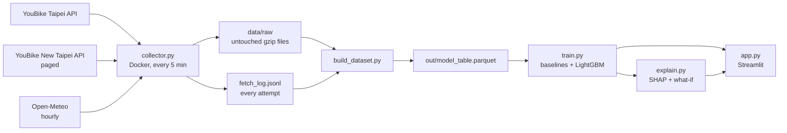
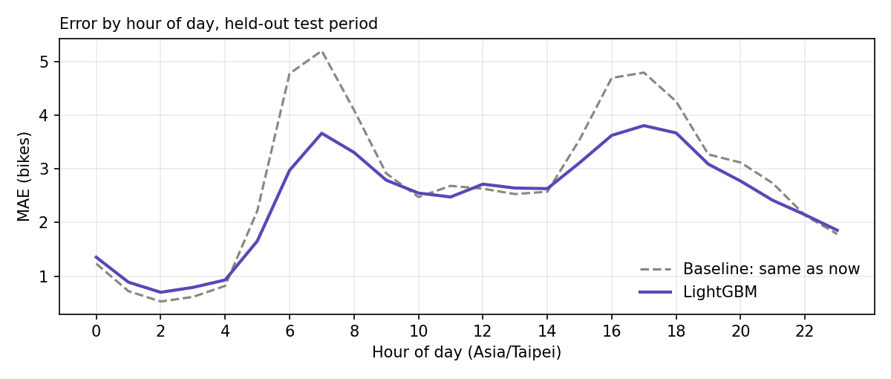
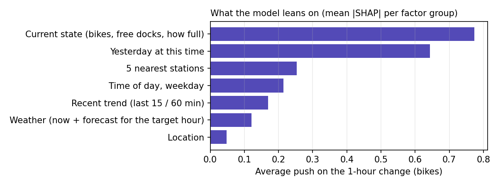
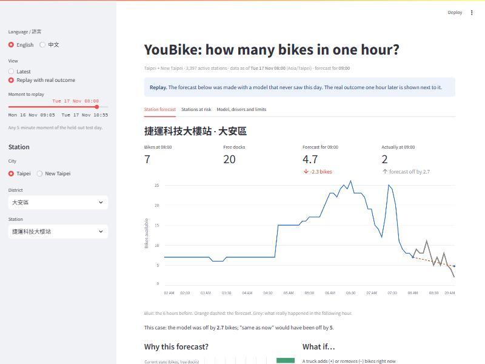

# YouBike: how many bikes in one hour?

*All numbers and charts in this file are generated by `make_report.py` from the latest pipeline run.*
*Data used: 2026-11-13 23:40 to 2026-11-19 20:45 (Asia/Taipei), 5.9 days.*

## 1. Summary

- **Goal.** Predict, for every YouBike station in Taipei and New Taipei, how many bikes it will have one hour from now, and explain what drives it.
- **Result.** On a held-out final 24 hours, LightGBM has a mean absolute error of **2.434 bikes** against **2.754** for the "same as now" baseline: **11.6% better**. When the count actually moves by 3+ bikes (34% of cases) the gain is **28.2%**.
- **Main driver.** The station's own state. Nearly full stations lose bikes, nearly empty ones gain. Then yesterday's pattern at the same time, then what nearby stations are doing.
- **Honest limit.** 5.9 days of data. The model is useful, not finished; the limits are in section 6.

## 2. Pipeline



| Step | File | What it guarantees |
|---|---|---|
| Collect | `collector.py` | Runs on a schedule in Docker (`restart: unless-stopped`). Stores the raw response bytes, named by our fetch time in UTC. Retries, then logs the failure and carries on. Weather runs in its own thread so it can never delay the bikes. |
| Clean | `build_dataset.py` | Reproducible from `data/raw` in about two minutes. One row per station per 5-minute slot. Drops duplicate fetches, partial New Taipei rounds and switched-off stations. |
| Model | `train.py` | Time-ordered split with a 1-hour gap. Two naive baselines and LightGBM. |
| Explain | `explain.py` | SHAP values per factor group, three what-if scenarios. |
| Present | `app.py` | Per-station forecast with its explanation, what-if sliders, at-risk map. English / 中文. |

## 3. Data

| | |
|---|---|
| Stations | 3,447 |
| Clean snapshot rows | 5,745,858 (13,785 duplicate rows removed) |
| Rows with features and a known answer | 5,577,528 |
| 5-minute slots expected / missing | 1,694 / 26 (98.5% covered) |
| Bike fetches succeeded / failed | 3,359 / 53 |
| Weather fetches succeeded / failed | 257 / 375 |

- **Gaps.** 2026-11-14 11:40:00 -> 2026-11-14 13:45:00. 52 of the 53 bike fetch failures fall in this window: DNS failures on the collecting machine, not the APIs. The collector logged them and resumed by itself. The other one was isolated and left no gap in the data.
- **Weather failures look worse than they are.** After a failure the collector retries every 10 minutes and logs each try. Every successful download carries a 48-hour forecast, so only 6 slots have no weather at all.
- **Time.** File names are UTC fetch times. Features use Asia/Taipei.
- **Leakage rule.** Each row only uses data fetched at or before its own slot. The weather for the target hour comes from the forecast we had already downloaded then, never from what was observed later.

Column-level documentation: [DATASET.md](DATASET.md).

## 4. Model and results

**Target.** Change in available bikes over the next hour, added back to the current count. **Model.** One LightGBM regressor (751 trees, L1 loss), 26 features.

**Split, by time and never random.**

| Part | Period | Role |
|---|---|---|
| Train | 2026-11-13 23:40 → 2026-11-18 00:55 | 3,837,692 rows the model learns from |
| Validation | 2026-11-18 02:00 → 2026-11-18 18:45 | Decides when to stop adding trees |
| Test | 2026-11-18 19:50 → 2026-11-19 19:45 | 972,287 forecasts, never seen, the only source of the scores below |

A 1-hour gap separates the parts, because a row at 09:20 already "knows" the 10:20 answer.

| Method | MAE (bikes) | RMSE | vs "same as now" |
|---|---|---|---|
| Baseline: same as now | 2.754 | 4.932 | — |
| Baseline: same as yesterday at that time | 4.583 | 6.660 | 66% worse |
| **LightGBM** | **2.434** | **4.028** | **11.6% better** |



- **"Same as now" is a strong baseline.** Most stations barely move within an hour. The honest comparison is on the rows that do move: 6.68 vs 4.79 bikes, **28.2% better**.
- **Hardest hour.** 07:00, where the baseline error is 5.20 bikes and the model's is 3.66.
- **"Same as yesterday" loses badly.** Copying yesterday also copies yesterday's one-off events: a truck that refilled a station at 08:00 yesterday may come at 09:30 today, and a busy hour yesterday may be quiet today. The current count already reflects today.
- **"Same time last week" is not possible** with 5.9 days of data.
- **Empty / full warnings.** When the model says a station will be empty it is right 71% of the time, but it catches 14% of the empty stations (baseline: 39% / 39%). For full: 82% right, 33% caught. Precise but not complete; the threshold is conservative.

## 5. Drivers and what-if

Each forecast is split into contributions with SHAP values. The table is the average size of each group's contribution, in bikes.

| Factor group | Average push (bikes) |
|---|---|
| Current state (bikes, free docks, how full) | 0.77 |
| Yesterday at this time | 0.64 |
| 5 nearest stations | 0.25 |
| Time of day, weekday | 0.21 |
| Recent trend (last 15 / 60 min) | 0.17 |
| Weather (now + forecast for the target hour) | 0.12 |
| Location | 0.05 |



- **Stations drift back to the middle.** How full the station is pushes the forecast by +0.43 bikes when it is under 10% full and by -1.11 when it is over 90% full.
- **Yesterday matters more than the calendar.** The change the station saw at this time yesterday is one of the strongest single signals.
- **Neighbours carry the area's direction.** If the five nearest stations are draining, this one probably is too.
- **Time of day matters most on weekday mornings**, 06:00 to 08:00.

**What-if scenarios** (take real rows, change one thing, predict again):

| Scenario | Result | Can it be trusted? |
|---|---|---|
| A truck adds 10 bikes at 08:00 on a weekday (2,556 stations) | On average **6.7** extra bikes are still there an hour later. Worst 10% of stations keep under 3.4; best 10% keep over 9.7. | Usable. Matches what happened after real sudden jumps in the test period. It is correlation, not a controlled experiment. |
| Same weekday morning, but labelled as a Sunday | 17.6% of stations change by 1+ bike (2.4% by 3+) | An early signal: on a Sunday the forecast changes by +0.21 bikes on average and busy commuter stations drain less. It is learned from only 2 weekend days, so treat it as a hint, not a finding. |
| 5 mm/h of rain | +0.27 bikes on average | **No.** The heaviest rain observed was 2.4 mm/h; 23% of rows had any rain. |

The first scenario is the operational one: it shows where added bikes stay and where they are gone within the hour.

### The app



The app has two views. **Latest** forecasts from the newest snapshot. **Replay** lets you pick any moment of the held-out test day and puts the forecast (orange, dashed) next to what really happened (grey), using the model that never saw that day. The screenshot (from an earlier run, so a different test day) also shows a rebalancing jump at about 04:30 that no public data announces.

## 6. Limits

- **5.9 days of data.** No weekly seasonality, one test day, weekday behaviour learned from very few weekdays. Scores will move as data accumulates.
- **Rebalancing is invisible.** Trucks move bikes and no public feed says when. Example: a station jumps from 4 to 20 bikes at 04:00. Errors of this kind cannot be removed with these sources.
- **Almost no rain** during collection, so the weather effect is not established.
- **Demand is censored.** An empty station shows zero rentals whatever the real demand was.
- **What-ifs are correlational.** They describe what followed similar situations in the past.
- **Single collector on a laptop.** One network outage cost 130 minutes of data.
- **The app shows the newest processed snapshot**, not a live feed.

## 7. With another month

1. **More history first.** Four to five weeks unlock the "same time last week" baseline, weekly patterns, holidays and rolling-origin backtests over many test days instead of one.
2. **Model flows, not stock.** Infer rentals and returns between snapshots, detect rebalancing events from sudden jumps and model them separately, handle censored demand at empty and full stations.
3. **Risk instead of a single number.** Quantile forecasts, calibrated probabilities of empty / full, thresholds tuned to the cost of a missed warning, horizons of 15, 30 and 60 minutes.
4. **More signals.** MRT ridership, events, school and public holidays, CWA rainfall radar for nowcasting, weather per district instead of two points.
5. **Operations.** Collector on a cloud VM with object storage, alerting on gaps, daily automatic retraining with a score history, and a live app.
6. **A recommendation, not just a forecast.** Turn the refill what-if into a ranked list: where should the next truck go so the bikes last.

## 8. Reproduce

```
docker compose up -d --build                           # collector
docker compose build ml
docker compose run --rm ml python build_dataset.py
docker compose run --rm ml python train.py
docker compose run --rm ml python explain.py
docker compose run --rm ml python export_app_data.py
docker compose run --rm ml python make_report.py
docker compose --profile app up app                    # http://localhost:8502
```
