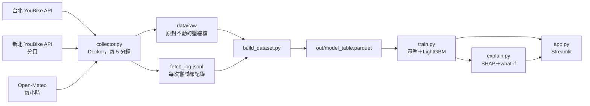
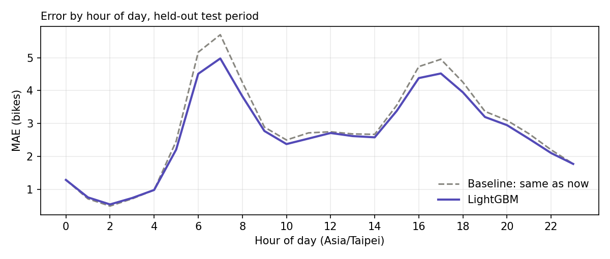
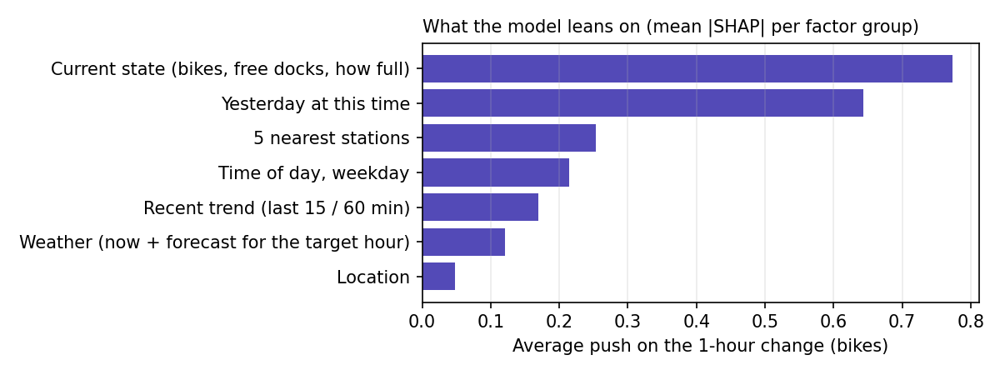
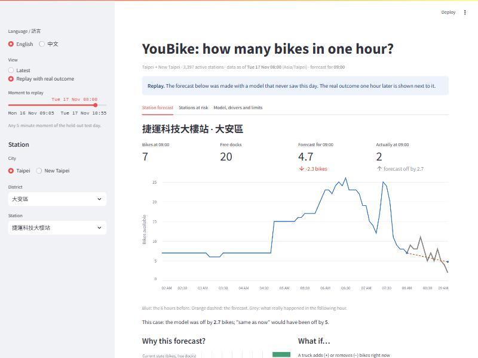

# YouBike：一小時後還有幾台車？

*本檔所有數字與圖表都由 `make_report.py` 從最新一次流程執行結果產生。*
*使用資料：2026-11-13 23:40 至 2026-11-19 20:45（台灣時間），共 5.9 天。*

## 1. 摘要

- **目標。** 預測台北與新北每個 YouBike 站點一小時後有幾台車，並解釋影響因素。
- **結果。** 用最後 24 小時（模型沒看過）驗證，LightGBM 的平均誤差是 **2.434 台**，「跟現在一樣」基準是 **2.754 台**，**好 11.6%**。車數實際變動 3 台以上時（佔 34%），好 **28.2%**。
- **主要驅動因素。** 站點自己的現況：快滿的站會掉車，快空的站會回升。其次是昨天同時段的型態，再來是鄰近站的動向。
- **誠實的限制。** 只有 5.9 天資料。模型有用，但還沒完成；限制見第 6 節。

## 2. 流程架構



| 步驟 | 檔案 | 保證什麼 |
|---|---|---|
| 收集 | `collector.py` | 在 Docker 內按排程執行（`restart: unless-stopped`）。原始回應原封不動存檔，檔名是我們的抓取時間（UTC）。失敗會重試，仍失敗就記錄後繼續。天氣跑在獨立執行緒，不會拖慢車數的抓取。 |
| 整理 | `build_dataset.py` | 約兩分鐘可從 `data/raw` 完整重現。每站每 5 分鐘一列。去除重複抓取、新北缺頁的輪次、停用的站點。 |
| 建模 | `train.py` | 按時間切分並留 1 小時間隔。兩個笨基準加 LightGBM。 |
| 解釋 | `explain.py` | 各類因素的 SHAP 值，三個 what-if 情境。 |
| 呈現 | `app.py` | 單站預測與其解釋、what-if 滑桿、風險地圖。中英文可切換。 |

## 3. 資料

| | |
|---|---|
| 站點數 | 3,447 |
| 乾淨快照列數 | 5,745,858（去除 13,785 列重複） |
| 有特徵且已知答案的列數 | 5,577,528 |
| 應有／缺少的 5 分鐘時段 | 1,694／26（涵蓋 98.5%） |
| 車數抓取 成功／失敗 | 3,421／53 |
| 天氣抓取 成功／失敗 | 263／375 |

- **缺口。** 2026-11-14 11:40:00 -> 2026-11-14 13:45:00。53 次車數抓取失敗中，有 52 次落在這段時間，原因是收集主機的 DNS 解析失敗，不是 API 的問題。收集程式有記錄並自行恢復。其餘 1 次是零星失敗，沒有造成資料缺口。
- **天氣失敗次數看起來多，實際影響小。** 失敗後每 10 分鐘重試一次，每次都記一行。每次成功下載都帶有 48 小時預報，所以完全沒有天氣資料的時段只有 6 個。
- **時間。** 檔名是 UTC 抓取時間，特徵使用台灣時間。
- **防洩漏規則。** 每一列只使用在該時段當下或之前抓到的資料。目標時段的天氣取自當時已下載的預報，不使用事後的觀測值。

欄位層級的說明見 [DATASET.md](DATASET.md)。

## 4. 模型與結果

**預測目標。** 未來一小時的車數變化量，再加回現在的車數。**模型。** 一個 LightGBM 迴歸模型（751 棵樹、L1 損失），26 個特徵。

**切分方式：按時間，絕不隨機。**

| 區段 | 期間 | 用途 |
|---|---|---|
| 訓練 | 2026-11-13 23:40 → 2026-11-18 00:55 | 模型學習用，3,837,692 列 |
| 驗證 | 2026-11-18 02:00 → 2026-11-18 18:45 | 決定何時停止增加樹 |
| 測試 | 2026-11-18 19:50 → 2026-11-19 19:45 | 972,287 筆預測，模型從未看過，下方成績只來自這一段 |

各區段之間留 1 小時間隔，因為 09:20 的那一列已經「知道」10:20 的答案。

| 方法 | 平均誤差 MAE（台） | RMSE | 相對「跟現在一樣」 |
|---|---|---|---|
| 基準：跟現在一樣 | 2.754 | 4.932 | — |
| 基準：跟昨天同時間一樣 | 4.583 | 6.660 | 差 66% |
| **LightGBM** | **2.434** | **4.028** | **好 11.6%** |



- **「跟現在一樣」是很強的基準。** 多數站點一小時內變化不大。公平的比較要看有變動的時候：6.68 對 4.79 台，**好 28.2%**。
- **最難的時段。** 07:00，基準誤差 5.20 台，模型 3.66 台。
- **「跟昨天一樣」輸很多。** 照抄昨天，也會照抄昨天的偶發事件：昨天 08:00 來補車，今天可能 09:30 才來；昨天的尖峰今天也可能很冷清。而「現在的車數」已經反映了今天的狀況。
- **「跟上週同時間一樣」做不到**，資料只有 5.9 天。
- **空站／滿站預警。** 模型說會空站時 71% 是對的，但只抓到 14% 的空站（基準為 39%／39%）。滿站：82% 正確，抓到 33%。準但不全，門檻設得保守。

## 5. 驅動因素與 what-if

每一筆預測都用 SHAP 值拆成各因素的貢獻。下表是各類因素貢獻的平均大小，單位是台。

| 因素類別 | 平均推力（台） |
|---|---|
| 站點現況（車數、空位、多滿） | 0.77 |
| 昨天同時段 | 0.64 |
| 最近的 5 個站 | 0.25 |
| 時段、星期幾 | 0.21 |
| 近期趨勢（過去 15／60 分鐘） | 0.17 |
| 天氣（現況＋目標時段預報） | 0.12 |
| 位置 | 0.05 |



- **站點會往中間靠。** 滿度低於 10% 時，「多滿」這條線索把預測推動 +0.43 台；高於 90% 時推動 -1.11 台。
- **昨天比日曆重要。** 站點昨天同時段的變化量是最強的單一訊號之一。
- **鄰近站帶出整個區域的方向。** 最近的五個站都在掉車，這一站多半也是。
- **時段的影響集中在平日早上** 06:00 到 08:00。

**what-if 情境**（取真實資料列，只改一項，重新預測）：

| 情境 | 結果 | 可信嗎？ |
|---|---|---|
| 平日 08:00 調度車補進 10 台（2,556 個站） | 一小時後平均還多 **6.7** 台。最差的一成站點留不到 3.4 台，最好的一成留超過 9.7 台。 | 可用。與測試期真實突增事件之後的走勢相符。它是相關性，不是對照實驗。 |
| 同一個平日早上，改標成週日 | 17.6% 的站點變動 1 台以上（3 台以上 2.4%） | 初步訊號：改成週日後，預測平均變動 +0.21 台，通勤站流失變少。但只從 2 個週末天學到，只能當線索，不能當結論。 |
| 降雨 5 mm／小時 | 平均 +0.27 台 | **不可信。** 觀測到的最大雨量是 2.4 mm／小時，有降雨的資料列佔 23%。 |

第一個情境有營運意義：它指出補進去的車在哪些站留得住，在哪些站一小時內就被借光。

### App

**線上試用：** https://youbike-forecast-mary.streamlit.app/（免費主機閒置後需要約一分鐘喚醒）



App 有兩種檢視。**最新**：用最新一筆快照做預測。**回放**：可選測試日的任一時間點，把預測（橘色虛線）和實際結果（灰線）並排，使用的是沒看過那一天的模型。截圖（來自較早的一次執行，所以是另一個測試日）裡也看得到凌晨 4:30 左右的一次調度跳升，這在公開資料中沒有任何預告。

## 6. 限制

- **只有 5.9 天資料。** 沒有週週期、測試日只有一天、平日行為只從極少數平日學到。資料累積後成績會變動。
- **看不到調度。** 調度車搬車沒有公開資料。例如某站在凌晨 04:00 從 4 台跳到 20 台，這類誤差無法用現有資料來源消除。
- **收集期間幾乎沒下雨**，天氣的影響尚未確立。
- **需求被截斷。** 空站的借車數是零，但真實需求不是零。
- **what-if 是相關性。** 它描述過去類似狀況之後發生了什麼。
- **只有一台筆電在收集。** 一次斷網就少了 130 分鐘資料。
- **App 顯示的是最新一次處理過的快照**，不是即時串流。

## 7. 如果再多一個月

1. **先累積歷史。** 四到五週的資料可以做「上週同時間」基準、週週期、假日，以及跨多個測試日的滾動回測。
2. **預測流量而不是存量。** 從相鄰快照推估借還量，從突增偵測調度事件並另外建模，處理空站與滿站時被截斷的需求。
3. **給風險而不是單一數字。** 分位數預測、校準過的空站／滿站機率、依漏報成本調整門檻、15／30／60 分鐘多個預測時距。
4. **更多訊號。** 捷運運量、活動、學校與國定假日、氣象署雷達降雨即時預報、分區天氣（目前只有兩個點）。
5. **維運。** 收集程式搬到雲端主機並使用物件儲存、缺口告警、每日自動重新訓練並保留成績歷史、即時更新的 App。
6. **從預測走到建議。** 把補車的 what-if 做成排序清單：下一輛調度車去哪裡，補的車留得最久。

## 8. 重現步驟

```
docker compose up -d --build                           # 收集程式
docker compose build ml
docker compose run --rm ml python build_dataset.py
docker compose run --rm ml python train.py
docker compose run --rm ml python explain.py
docker compose run --rm ml python export_app_data.py
docker compose run --rm ml python make_report.py
docker compose --profile app up app                    # http://localhost:8502
```
